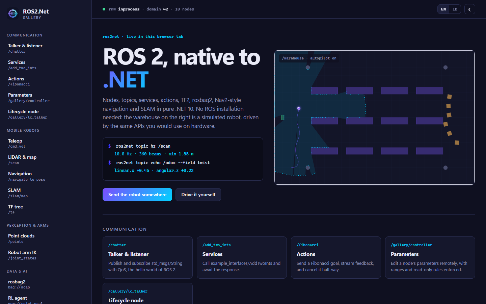

<p align="center">
  
</p>

<h1 align="center">ROS2.Net</h1>

<p align="center">
  <b>A pure .NET 10 implementation of ROS 2</b> — nodes, topics, services, actions, parameters, lifecycle,
  DDS-RTPS networking, TF2, rosbag2, navigation, SLAM, control, manipulation, perception, simulation and AI,
  with Blazor &amp; Avalonia components. <b>No ROS 2 installation required.</b>
</p>

<p align="center">
  Made by <b>Gravicode Studios</b>, led by <b>Kang Fadhil</b> ·
  Dibuat oleh <b>Gravicode Studios</b> dipimpin oleh <b>Kang Fadhil</b>
</p>

<p align="center"><a href="#english">English</a> · <a href="#bahasa-indonesia">Bahasa Indonesia</a></p>

<p align="center">
  
  
</p>

---

## English

### Why ROS2.Net
- **Native .NET client library** — idiomatic C# (async/await, `IAsyncEnumerable`, `ILogger`, DI) mirroring rclcpp concepts.
- **Talks to real ROS 2** — a managed DDS-RTPS middleware (Fast DDS / Cyclone DDS wire protocol, ROS name mangling, graph discovery) and a rosbridge middleware; or zero-copy in-process for composed systems and tests.
- **Batteries included** — TF2, rosbag2 (MCAP), Nav2-style navigation, SLAM, AMCL/EKF, ros2_control-style controllers, MoveIt-style kinematics & planning, point-cloud/image perception with Rust acceleration, a robot simulator, RL/ONNX/LLM integration, SROS2 keystores.
- **Tooling** — `ros2net` CLI (topic/service/action/param/bag/interface/security/doctor), `dotnet new` templates, Blazor & Avalonia components, the ROS2.Net Gallery (web + desktop) and a desktop Robot Simulator.
- **Performance** — allocation-aware CDR serialization with array reuse, pooled buffers, per-entity bounded queues, a shared high-resolution timer thread, real-time executor.

### Quick start

```bash
dotnet add package ROS2.Net
```

```csharp
using ROS2.Net;
using StdMsgs = ROS2.Net.Msgs.StdMsgs;

await using var ctx = await Ros2Context.CreateAsync(new Ros2ContextOptions().UseRtps()); // talk to ROS 2 on the LAN
var node = ctx.CreateNode("talker");
var pub = node.CreatePublisher<StdMsgs.String>("chatter");
node.CreateTimer(TimeSpan.FromSeconds(0.5), () => pub.Publish(new() { Data = "Hello from .NET" }));
await ctx.SpinAsync();
```

Then from a ROS 2 machine: `ros2 topic echo /chatter` — or with our CLI: `ros2net topic echo /chatter`.

### Packages

| Package | Contents |
|---|---|
| `ROS2.Net` | Umbrella: Core, Msgs, RTPS, rosbridge, TF2, Bag, Hosting |
| `ROS2.Net.Core` | Nodes, pub/sub, services, actions, parameters, lifecycle, executors, QoS, CDR, in-process RMW |
| `ROS2.Net.Msgs` | Standard interfaces (std/geometry/sensor/nav/tf2/visualization/trajectory/diagnostic/control/nav2 …) |
| `ROS2.Net.Rosidl`, `ROS2.Net.Rosidl.Generator` | `.msg/.srv/.action` parser and Roslyn source generator |
| `ROS2.Net.Rmw.Rtps` | Managed DDS-RTPS middleware |
| `ROS2.Net.Rmw.Rosbridge` | rosbridge v2 WebSocket middleware |
| `ROS2.Net.Hosting` | `services.AddRos2(...)`, DI-constructed nodes |
| `ROS2.Net.Security` | SROS2 keystores, enclaves, governance/permissions |
| `ROS2.Net.Tf2` | Transform buffer, listener, broadcasters |
| `ROS2.Net.Bag` | rosbag2 MCAP recorder/player/reader/exporter |
| `ROS2.Net.Navigation` | Costmaps, A*/Theta*/Hybrid-A*, Pure Pursuit/RPP/DWB, BT, AMCL, EKF, SLAM, Nav2 servers |
| `ROS2.Net.Perception`, `.Perception.Onnx`, `.Native` | Point clouds, images, camera models, detection; Rust kernels |
| `ROS2.Net.Control`, `ROS2.Net.Manipulation` | ros2_control-style controllers; URDF, FK/IK, RRT-Connect, time parameterization |
| `ROS2.Net.Simulation`, `ROS2.Net.AI` | Robot simulator engine; RL gym, ONNX, LLM commander, anomaly detection |
| `ROS2.Net.Blazor`, `ROS2.Net.Avalonia` | UI components |
| `ROS2.Net.Cli`, `ROS2.Net.Templates` | `ros2net` tool, `dotnet new` templates |

### Gallery & simulator

<p align="center">
  
  
</p>

```bash
dotnet run --project apps/ROS2.Net.Gallery.Web       # web gallery (Blazor)
dotnet run --project apps/ROS2.Net.Gallery.Desktop   # desktop gallery (Avalonia)
dotnet run --project apps/ROS2.Net.Simulator         # robot simulator
dotnet run --project apps/ROS2.Net.Cli -- doctor     # CLI
```

### Build from source

```bash
cargo build --release --manifest-path native/ros2net_native/Cargo.toml   # optional native acceleration
dotnet build ROS2.Net.slnx
dotnet test ROS2.Net.slnx
```

### Documentation

[docs/en](docs/en/README.md) — getting started, concepts, interfaces, every library, tools. See also [PLAN.md](PLAN.md) and [Progress.md](Progress.md).

### Status

Version 0.1 (preview). Interoperability with Fast DDS / Cyclone DDS and rosbridge follows the
specifications and is tested ROS2.Net-to-ROS2.Net; validation against real ROS 2 installations is
the next milestone — see [Progress.md](Progress.md).

License: MIT.

---

## Bahasa Indonesia

### Mengapa ROS2.Net
- **Client library .NET asli** — C# idiomatis (async/await, `IAsyncEnumerable`, `ILogger`, DI) yang mengikuti konsep rclcpp.
- **Berbicara dengan ROS 2 sungguhan** — middleware DDS-RTPS terkelola (protokol kabel Fast DDS / Cyclone DDS, penamaan ROS, discovery graph) dan middleware rosbridge; atau in-process tanpa salinan untuk sistem terkomposisi dan pengujian.
- **Lengkap** — TF2, rosbag2 (MCAP), navigasi ala Nav2, SLAM, AMCL/EKF, controller ala ros2_control, kinematika & perencanaan ala MoveIt, persepsi point cloud/citra dengan akselerasi Rust, simulator robot, integrasi RL/ONNX/LLM, keystore SROS2.
- **Tooling** — CLI `ros2net`, template `dotnet new`, komponen Blazor & Avalonia, ROS2.Net Gallery (web + desktop), dan Robot Simulator desktop.
- **Performa** — serialisasi CDR hemat alokasi dengan pemakaian ulang array, buffer pool, antrean terbatas per entitas, satu thread timer resolusi tinggi bersama, executor real-time.

### Mulai cepat

```bash
dotnet add package ROS2.Net
```

```csharp
await using var ctx = await Ros2Context.CreateAsync(new Ros2ContextOptions().UseRtps()); // berbicara dengan ROS 2 di LAN
var node = ctx.CreateNode("talker");
var pub = node.CreatePublisher<StdMsgs.String>("chatter");
node.CreateTimer(TimeSpan.FromSeconds(0.5), () => pub.Publish(new() { Data = "Halo dari .NET" }));
await ctx.SpinAsync();
```

Lalu dari mesin ROS 2: `ros2 topic echo /chatter` — atau dengan CLI kami: `ros2net topic echo /chatter`.

### Galeri & simulator

```bash
dotnet run --project apps/ROS2.Net.Gallery.Web       # galeri web (Blazor)
dotnet run --project apps/ROS2.Net.Gallery.Desktop   # galeri desktop (Avalonia)
dotnet run --project apps/ROS2.Net.Simulator         # simulator robot
```

### Dokumentasi

[docs/id](docs/id/README.md) — memulai, konsep, interface, setiap library, dan tool. Lihat juga [PLAN.md](PLAN.md) dan [Progress.md](Progress.md).

### Status

Versi 0.1 (pratinjau). Interoperabilitas dengan Fast DDS / Cyclone DDS dan rosbridge dibangun
mengikuti spesifikasi dan diuji antar-ROS2.Net; validasi terhadap instalasi ROS 2 sungguhan adalah
tahap berikutnya — lihat [Progress.md](Progress.md).

Lisensi: MIT.
