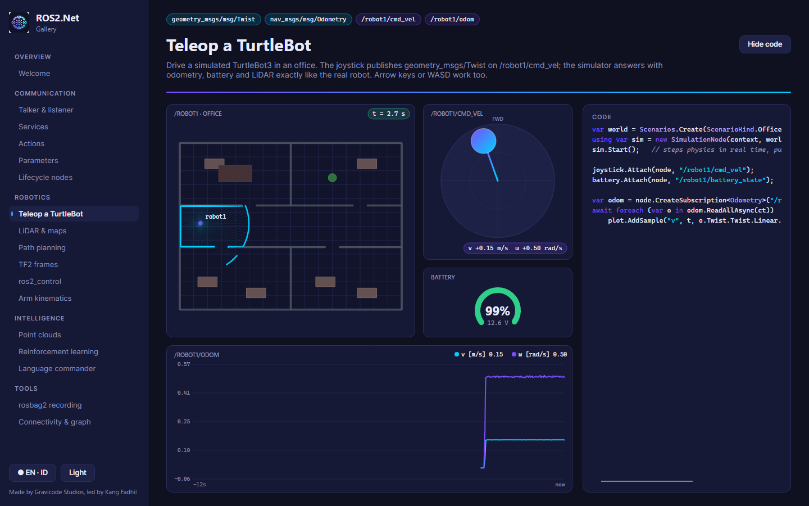

# Avalonia UI controls — `ROS2.Net.Avalonia`

> Made by Gravicode Studios, led by Kang Fadhil.

Desktop controls for robot UIs on Avalonia 12. They are custom-drawn, so they stay fast at sensor rates and have no template dependencies. They follow one design system: violet → cyan signal accents on deep navy, from the package icon. Light and dark palettes are both available.

```bash
dotnet add package ROS2.Net.Avalonia
```



## Controls

| Control | Shows / does | Attach |
|---|---|---|
| `TeleopJoystick` | Drag the knob or use arrows/WASD to produce `geometry_msgs/Twist`. Publishes at 10 Hz while deflected and sends one final zero. | `Attach(node, "/cmd_vel")` |
| `LaserScanView` | Polar `sensor_msgs/LaserScan` with range rings, coloured by range | `Attach(node, "/scan")` |
| `OccupancyGridView` | Map or costmap with pan/zoom. Overlays: robots, path, goal, points. `WorldClicked` gives map coordinates. | `Attach(node, "/map", "/plan")` |
| `PointCloudView` | xyz clouds in top, side, front or orbit projection, in layers. Colour by height or fixed. | `SetPoints(xyz)` / `AddLayer(...)` |
| `ImageView` | `sensor_msgs/Image`: rgb8, bgr8, rgba8, bgra8, mono8, mono16, 16UC1, 32FC1. Depth images are normalized. | `Attach(node, "/camera/image_raw")` |
| `PlotView` | Real-time multi-series plot (rqt_plot style), auto-scaled, sliding window | `AddSample(series, t, v)` from any thread |
| `LogConsole` | `/rosout` coloured by level, with filter and scroll-back | `Attach(node)` |
| `TopicMonitor` | Every topic with type, pub/sub counts, Hz and bandwidth, measured with raw (serialized) subscriptions | `Attach(node)` |
| `NodeGraphView` | rqt_graph-style nodes → topics → nodes graph | `Attach(node)` |
| `TfTreeView` | The frame tree of a `TfBuffer`, with translations | `Buffer = tfBuffer` |
| `ParameterEditor` | Edit any node's parameters through its parameter services. Shows types, descriptions and rejections. | `await AttachAsync(node, "/robot/controller")` |
| `BatteryGauge` | `sensor_msgs/BatteryState` arc gauge | `Attach(node, "/battery_state")` |
| `JointStatePanel` | One bar per joint within its limits | `Attach(node, "/joint_states")` |
| `SimWorldView` | Top-down `ROS2.Net.Simulation` world: obstacles, robots, LiDAR rays, trails | `Attach(simWorld)` |

## Threading

ROS callbacks never touch controls directly. `RosUi` bridges topics to the UI thread:

```csharp
// Newest message only; intermediate ones are dropped, so a 1 kHz topic cannot flood the UI.
using var sub = RosUi.SubscribeLatest<Odometry>(node, "/odom", o => speed.Text = $"{o.Twist.Twist.Linear.X:0.00}");

// Every message, batched per UI frame (logs, events).
using var logs = RosUi.SubscribeAll<Log>(node, "/rosout", batch => { foreach (var m in batch) console.Append(DateTime.Now, m.Level, m.Name, m.Msg); });
```

Both use callback-less subscriptions, so they work whether or not the node is spinning.

## Theme

```csharp
RosTheme.IsDark = false;          // switches palette and the Fluent theme variant; controls redraw
var p = RosTheme.Current;         // Background, Surface, Seam, Ink, Haze, Signal, Telemetry, Alert, Fault, Ok
border.Background = p.SignalGradient();
```

Use `.WithInterFont()` on your `AppBuilder` for the intended typography. Data and topic names use a monospace font (Cascadia Mono / Consolas / Menlo).

## Minimal app

```csharp
var context = await Ros2Context.CreateAsync(new Ros2ContextOptions().UseRtps());
_ = context.SpinAsync();
var node = context.CreateNode("dashboard");

var joystick = new TeleopJoystick();
joystick.Attach(node, "/cmd_vel");
var scan = new LaserScanView();
scan.Attach(node, "/scan");
window.Content = new Grid { ColumnDefinitions = new("*,*"), Children = { joystick, scan } };
Grid.SetColumn(scan, 1);
```

See the [gallery](gallery.md) for every control in context, and the [simulator](simulator.md) for a complete app.
