# ROS2.Net Gallery (web)

`apps/ROS2.Net.Gallery.Web` is a Blazor Web App that shows ROS2.Net through 16 live demos. Every demo
runs in the browser tab against a simulated warehouse robot on the in-process middleware. **No ROS 2
installation is needed.** Each page has a **Live demo** tab and a **View code** tab with the matching
snippet. The UI switches between English and Bahasa Indonesia, and between dark and light themes.

> Made by Gravicode Studios, led by Kang Fadhil.

```bash
cd apps/ROS2.Net.Gallery.Web
dotnet run            # http://localhost:5310 (Development profile)
```


## What is running

At startup `GalleryRuntime` (a hosted service) starts the following:

- **Simulation:** a `Warehouse` world from ROS2.Net.Simulation with one robot in the root namespace. It publishes `/cmd_vel`, `/odom`, `/scan`, `/imu`, `/camera/image_raw`, `/battery_state`, `/map`, `/tf` and `/clock`.
- **Navigation stack:** the Nav2-style `planner_server`, `controller_server` and `bt_navigator`, with the ground-truth pose as their pose provider.
- **Demo servers:**
  - `/talker` (publishes `/chatter`)
  - `/add_two_ints`
  - the `/fibonacci` action
  - `/gallery/controller` (parameters)
  - `/gallery/lc_talker` (a lifecycle node)
- **Autopilot:** a reactive wanderer that keeps the robot moving. Pages that drive the robot hold it (`GalleryRuntime.HoldAutopilot()`).

## Pages

| Page | Shows | |
|---|---|---|
| Talker & listener | publish/subscribe, `/rosout` console | 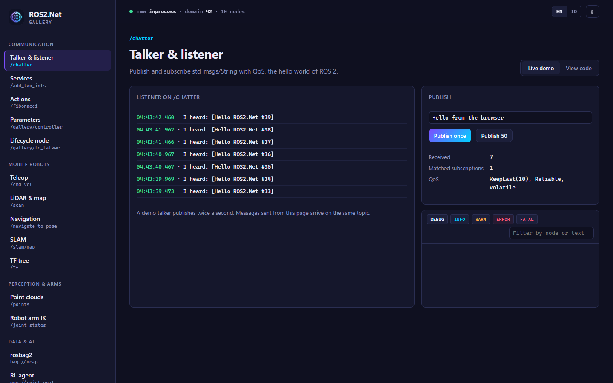 |
| Services | `AddTwoInts`, 100 concurrent calls | 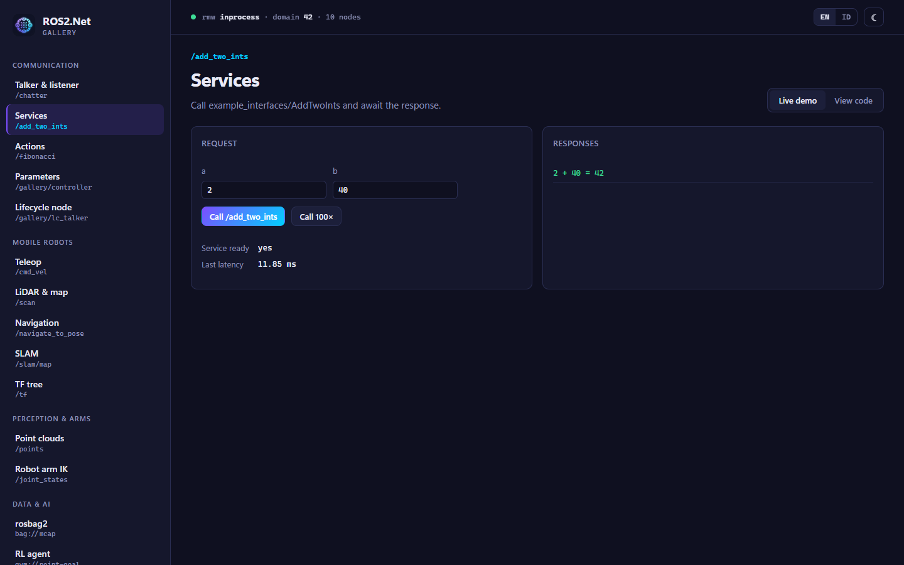 |
| Actions | Fibonacci goal, feedback stream, cancel | 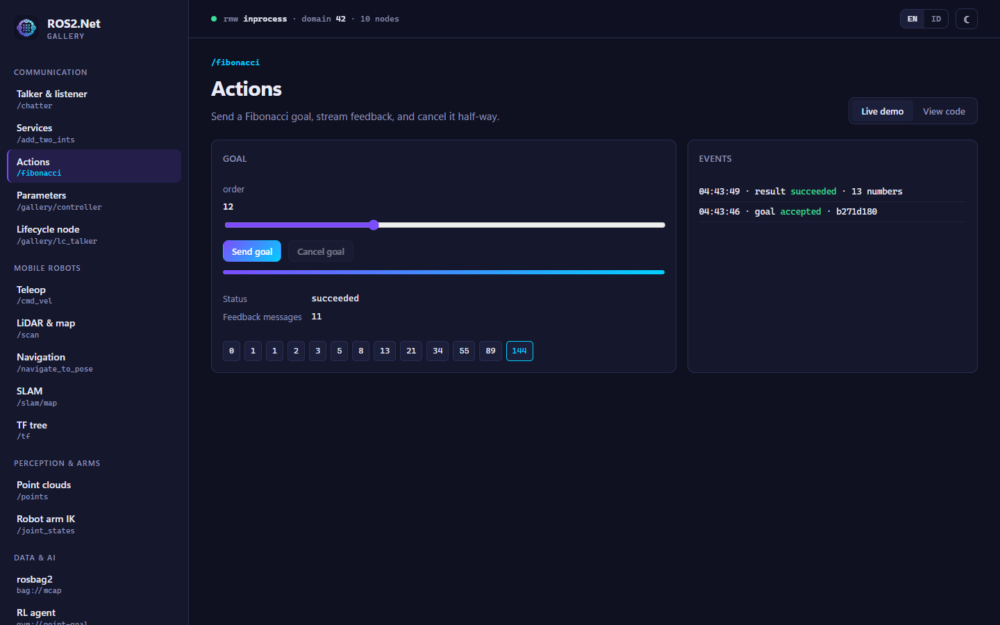 |
| Parameters | `ParameterEditor` with ranges and read-only rules, `/parameter_events` | 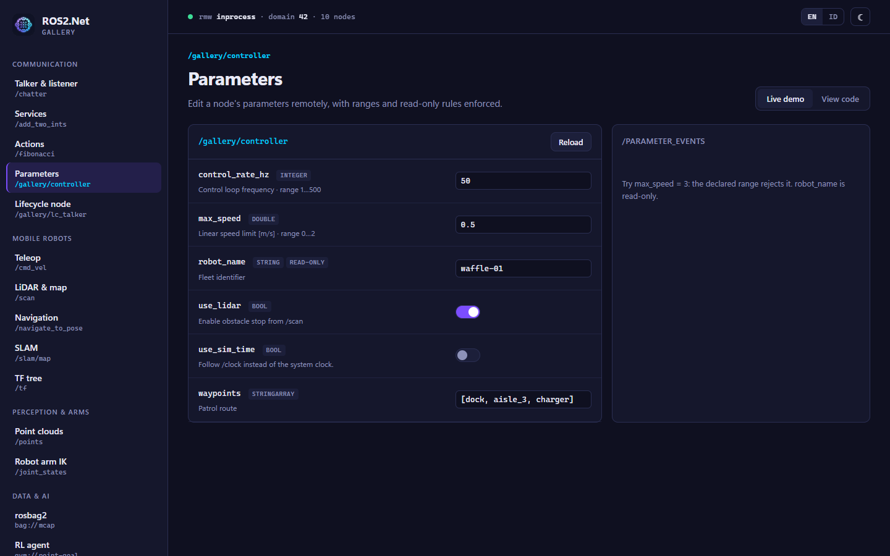 |
| Lifecycle node | state machine control, lifecycle publisher | 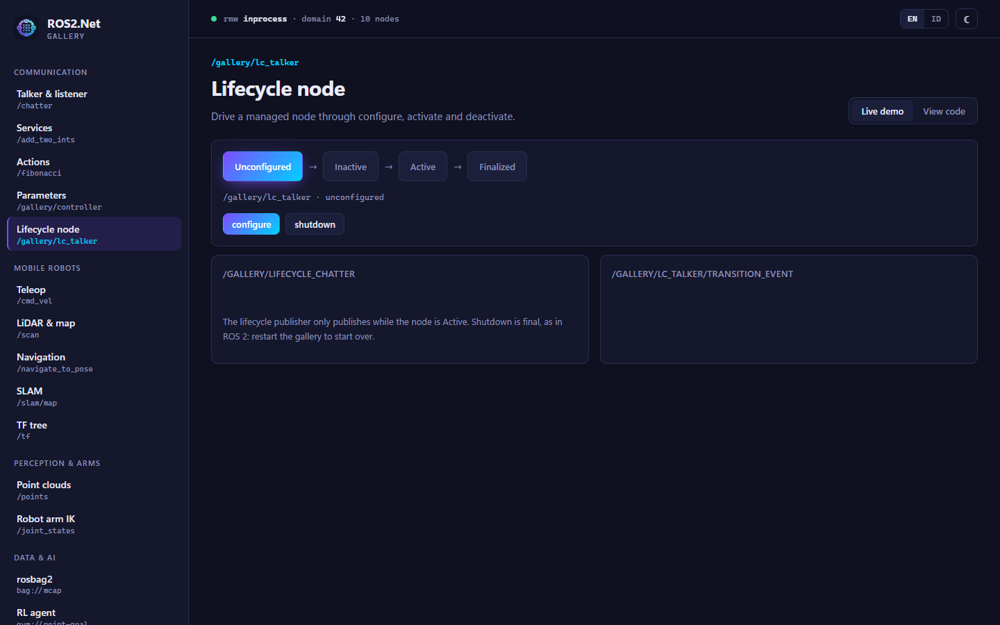 |
| Teleop | joystick or W A S D → `/cmd_vel`, live velocity plot | 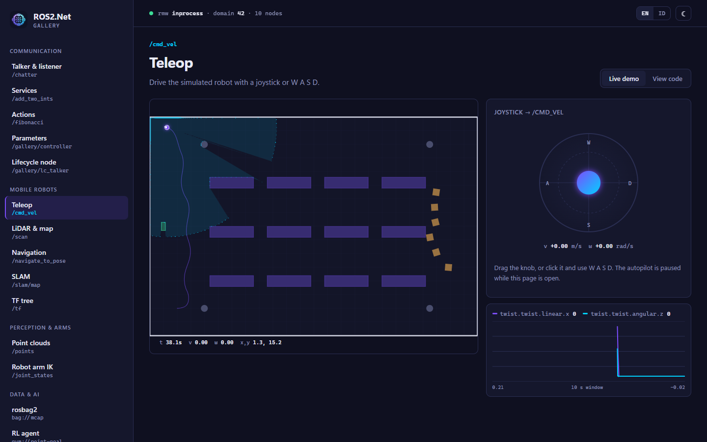 |
| LiDAR & map | occupancy grid, laser scan, camera, battery, IMU plot |  |
| Navigation | click the map → `NavigateToPose` → A* plan → RPP control |  |
| SLAM | live graph-SLAM map from `/scan` + `/odom`, pose-graph stats |  |
| TF tree | frame tree, `tf2_echo`, Mermaid `view_frames` | 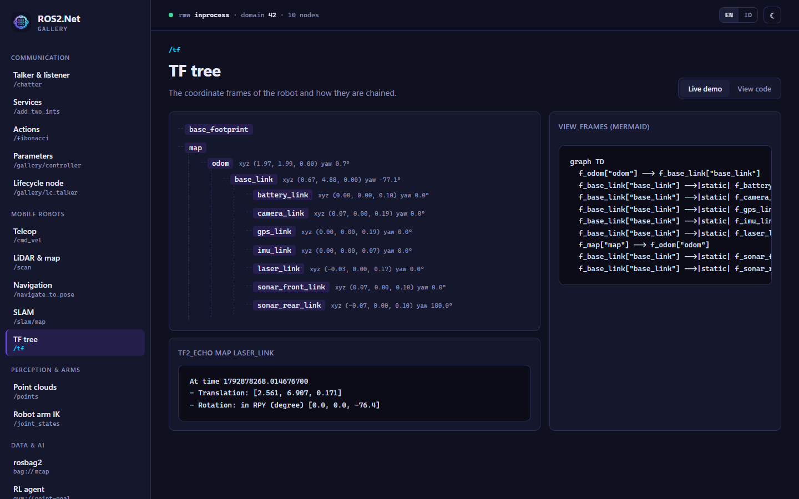 |
| Point clouds | voxel, outlier removal, RANSAC planes, Euclidean clusters (Rust kernels) | 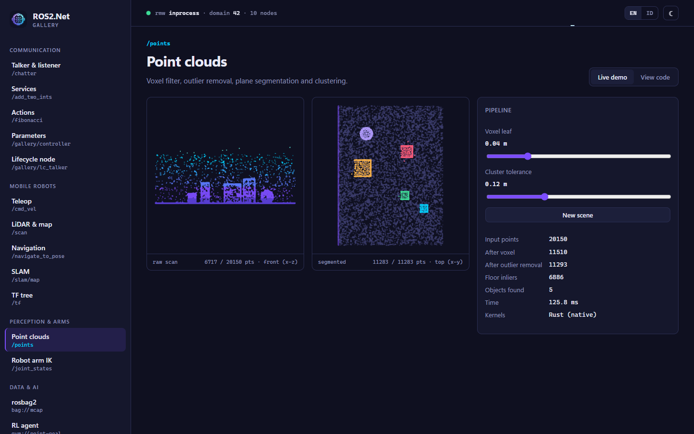 |
| Robot arm IK | UR5 inverse kinematics from sliders, `/joint_states` | 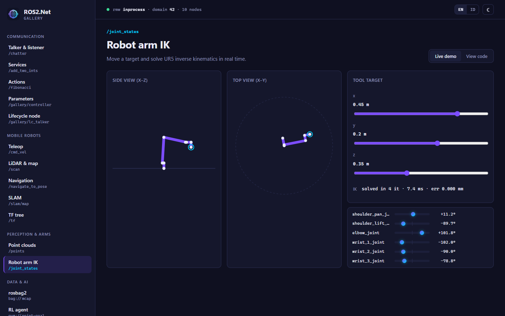 |
| rosbag2 | record 5 s to MCAP (zstd), `bag info`, 2× replay, JSONL export | 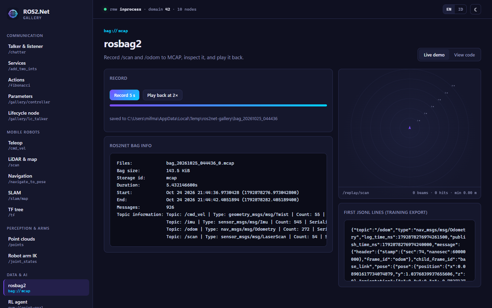 |
| RL agent | Q-learning on the point-goal gym env, return curve, policy rollouts | 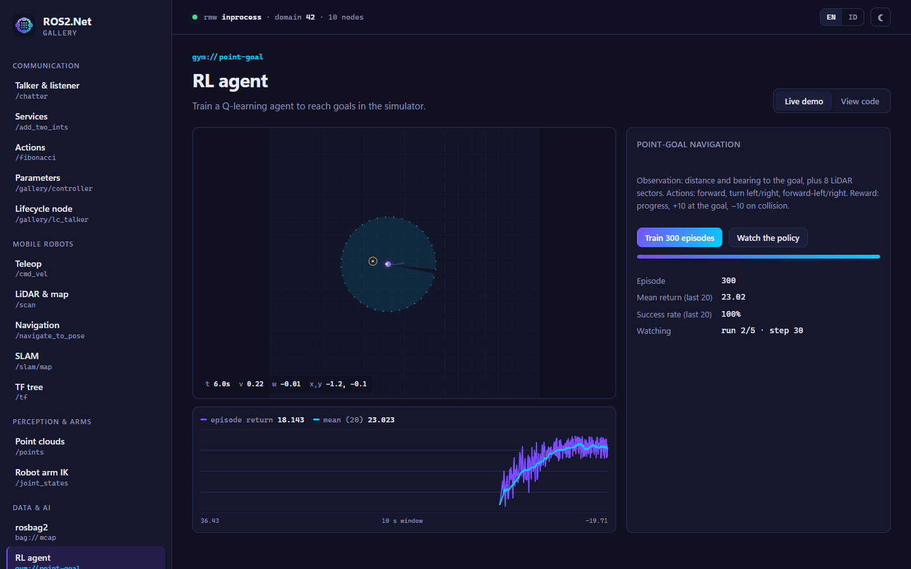 |
| Language commander | English or Indonesian commands → safe motion (rule-based model, offline) | 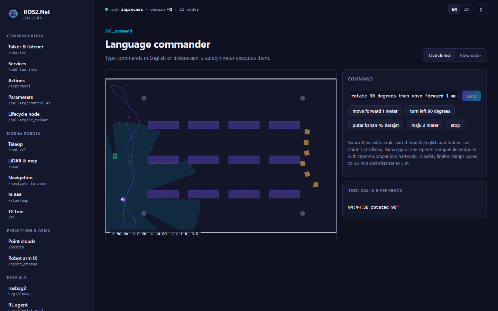 |
| Connectivity | node graph, topic monitor, probe an RTPS domain or rosbridge URL | 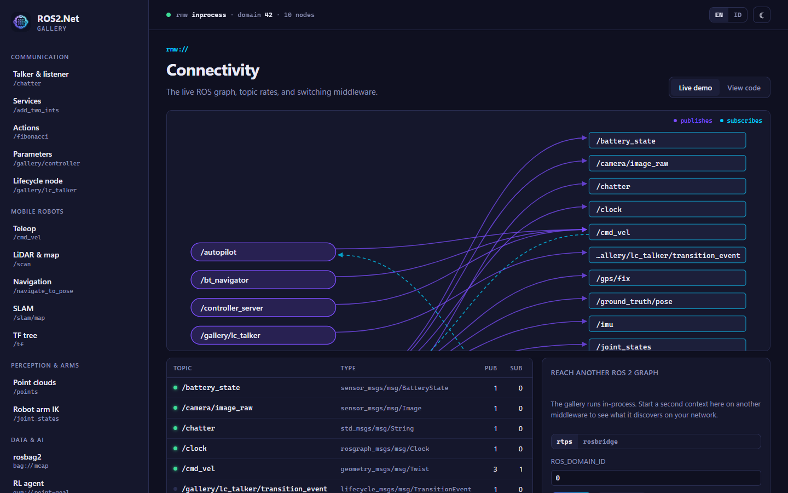 |


## Talking to a real ROS 2 system

The demos use the in-process middleware so they work anywhere. To drive real robots, change one line
in `Program.cs`, for example `o.Rmw = "rtps"`, and remove the simulator from `GalleryRuntime`. The
Connectivity page probes an RTPS domain or a rosbridge URL without restarting.

## Screenshots

`tests/ROS2.Net.Blazor.Tests/Screenshots.cs` regenerates every image in `docs/images/web` with
Playwright and the installed Microsoft Edge. Bundled Chromium is the fallback. The test is opt-in:

```bash
dotnet build apps/ROS2.Net.Gallery.Web
# either start the app yourself and point the test at it:
ROS2NET_GALLERY_URL=http://localhost:5317 dotnet test tests/ROS2.Net.Blazor.Tests --filter Screenshots
# or let the test start it:
ROS2NET_SCREENSHOTS=1 dotnet test tests/ROS2.Net.Blazor.Tests --filter Screenshots
```

`ROS2NET_SCREENSHOT_PAGES=home,lidar` limits the run to some pages.

## Design notes

- **Palette:** deep navy surfaces with a violet → cyan accent, taken from the NuGet icon.
- **Type:** Inter (with a Segoe UI fallback) for text; JetBrains Mono (with a Cascadia Code / Consolas fallback) for ROS names.
- **Navigation:** every entry shows the ROS name it is about (`/navigate_to_pose`, `/scan`, and so on). That way the sidebar doubles as a map of the ROS graph.
- **Live hero:** the home page shows the live warehouse with its LiDAR sweep, plus a terminal block with real readouts of `/scan` and `/odom`.
- **Accessibility:** responsive down to mobile, visible keyboard focus, and `prefers-reduced-motion` is respected.
