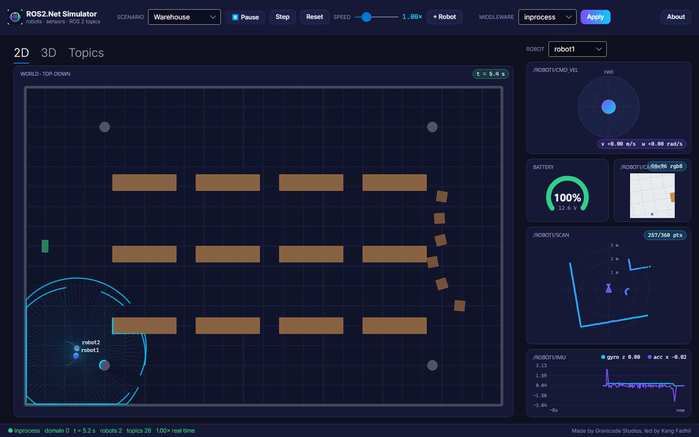

# Robot Simulator (desktop app)

> Made by Gravicode Studios, led by Kang Fadhil.

`apps/ROS2.Net.Simulator` is a desktop front end for `ROS2.Net.Simulation`. Pick a scenario, drive the robots and watch their sensors. Every robot is published as standard ROS 2 topics on the middleware you choose, so external nodes can use the simulator as if it were real hardware: Nav2, RViz, `ros2 topic`, or your own ROS2.Net code.

```bash
dotnet run --project apps/ROS2.Net.Simulator                                    # in-process
dotnet run --project apps/ROS2.Net.Simulator -- --rmw rtps --scenario Office    # visible to ROS 2 on the LAN
dotnet run --project apps/ROS2.Net.Simulator -- --rmw rosbridge                 # through rosbridge_server
```



## Features

| Area | What you get |
|---|---|
| Scenarios | Warehouse (two robots), Office, Maze, Corridor loop, Agriculture rows, Empty |
| Views | **2D**: top-down view with obstacles, LiDAR rays, trails and heading; pan and zoom; click a robot to select it. **3D**: a Three.Net GPU view with obstacles extruded to their heights; drag to orbit, wheel to zoom. It is created only when the tab is opened. **Topics**: live topic table (Hz and bandwidth) plus example `ros2` commands. |
| Control | Play/pause, step, reset, real-time factor 0.25–4×, **+ Robot** spawns a new robot in free space |
| Robot panel | Joystick on `/<robot>/cmd_vel`, battery gauge, camera image, LiDAR, IMU plot (gyro z, accel x) |
| Middleware | `inprocess`, `rtps` (domain from `ROS_DOMAIN_ID`) or `rosbridge` (URL field). **Apply** restarts the simulation on the new middleware. |
| Status bar | Middleware, domain, simulation time, robots, topic count, real-time factor |

## Topics per robot

The topics are those of `SimulationNode` (see [simulation.md](simulation.md)):

- `cmd_vel`
- `odom`
- `scan`
- `imu`
- `gps/fix`
- `battery_state`
- `sonar_front`, `sonar_rear`
- `camera/image_raw`
- `joint_states`
- `ground_truth/pose`

Global topics are `/tf`, `/tf_static`, `/clock` and the latched `/map`. The simulator enables `map → odom` so multi-robot TF trees connect.

```bash
# from a ROS 2 machine on the same network, with --rmw rtps
ros2 topic echo /robot1/odom
ros2 topic pub /robot1/cmd_vel geometry_msgs/msg/Twist "{linear: {x: 0.2}, angular: {z: 0.4}}"
```

## Notes

- The 3D view needs a GPU renderer (Three.Net native runtime). If it cannot start, the tab shows a message and the 2D view stays fully functional. The headless screenshot covers the 2D view only.
- Wire interop of the `rtps` middleware with Fast DDS and Cyclone DDS has not been verified on a real ROS 2 installation yet. See [rtps.md](rtps.md).
