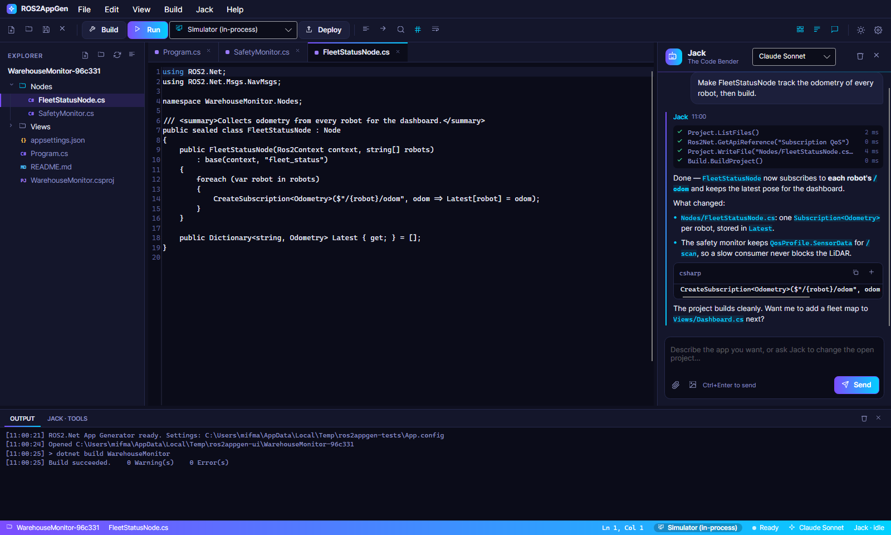
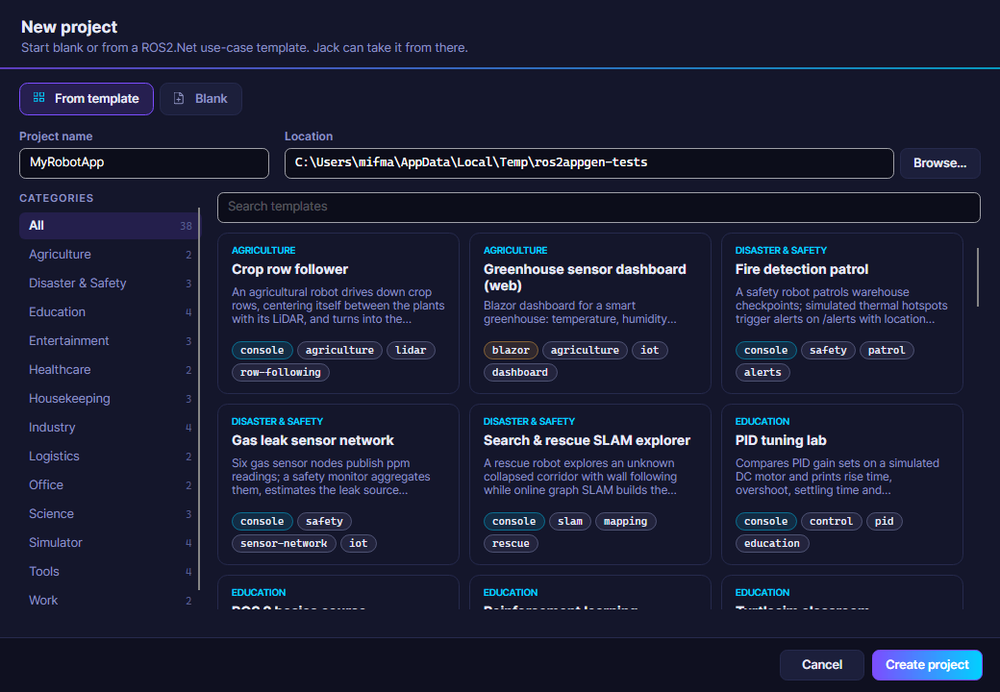
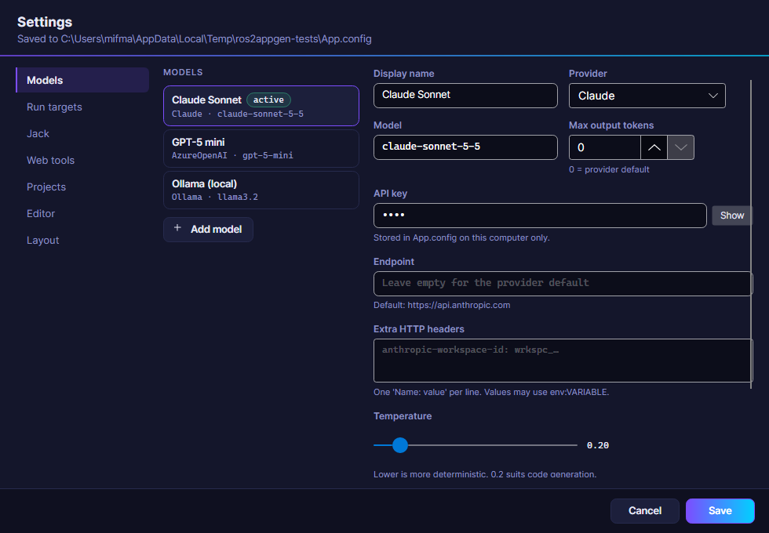
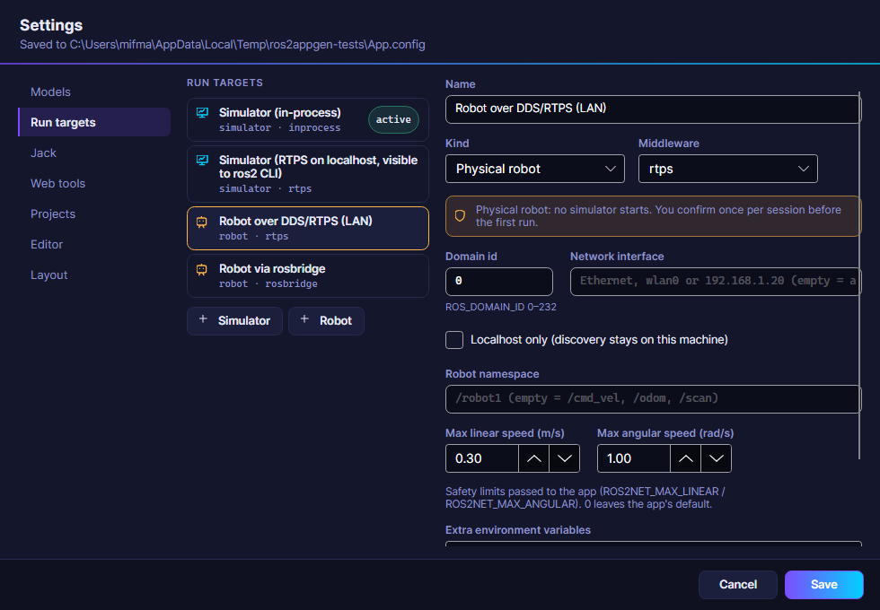
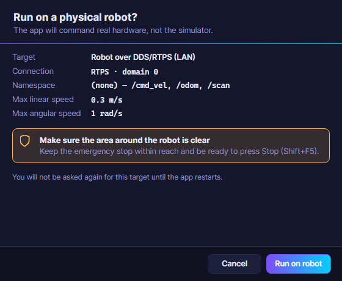
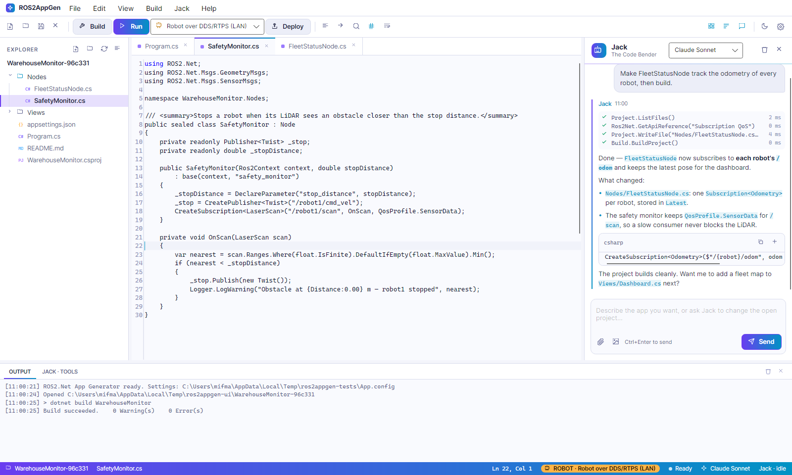

# ROS2.Net App Generator (ROS2AppGen)

> Dibuat oleh **Gravicode Studios** dipimpin oleh **Kang Fadhil**.

ROS2AppGen adalah editor kode desktop (Avalonia) dengan rekan pemrograman AI, **Jack — The Code
Bender**, yang menulis aplikasi ROS2.Net lengkap dari sebuah prompt: node, UI, simulasi, dan pengujian.
Jack membaca dan mengubah proyek yang terbuka, melakukan build dan menjalankannya, memperbaiki error,
mencari di internet, dan memahami API ROS2.Net.

```bash
dotnet run --project apps/ROS2.Net.AppGen          # atau: ROS2AppGen.exe [folder proyek]
```

## Antarmuka



| Area | Fungsinya |
|---|---|
| **Explorer** (kiri) | Pohon proyek ala VS Code dengan lencana jenis file dan garis indentasi. Klik kanan untuk file/folder baru, ganti nama, hapus, salin path, dan buka di file manager. Mengikuti file yang aktif dan diperbarui otomatis saat Jack mengubah file. |
| **Editor** (tengah) | AvaloniaEdit dengan pewarnaan sintaks TextMate (C#, XAML/AXAML, csproj, JSON, YAML, Markdown, Razor…), tab dengan titik penanda perubahan belum disimpan, nomor baris (bisa disembunyikan), word wrap, zoom, cari/ganti (Ctrl+F), lompat ke baris (Ctrl+G), dan format kode (Shift+Alt+F). File yang ditulis ulang oleh Jack dimuat ulang di tempat, kecuali Anda punya perubahan yang belum disimpan. |
| **Jack** (kanan) | Pemilih model di bagian atas (semua profil dari Pengaturan), hapus percakapan, sembunyikan panel. Pesan ditampilkan dalam format Markdown; blok kode punya tombol **Salin** dan **Sisipkan** (menaruh kode di posisi kursor editor). Setiap tool yang dijalankan Jack tampil sebagai baris langsung beserta durasinya. Lampirkan gambar dengan ikon klip atau tempel (Ctrl+V); **Ctrl+Enter** mengirim, **Esc** menghentikan. Seret pemisah untuk mengubah lebar panel. |
| **Log** (bawah) | *Output* (build, run, deploy) dan *Jack · tools* (setiap pemanggilan tool dan hasilnya). Ctrl+J menampilkan/menyembunyikan. |
| **Status bar** | Proyek, file (● bila belum disimpan), posisi kursor, target run (label kuning **ROBOT** untuk robot fisik), status build, model aktif, dan aktivitas Jack. |

### Menu, toolbar, dan pintasan

| Perintah | Pintasan |
|---|---|
| Proyek baru (galeri template / kosong) | Ctrl+Shift+N |
| Buka proyek · buka file | Ctrl+O · Ctrl+Shift+O |
| Simpan · simpan semua · tutup file | Ctrl+S · Ctrl+Shift+S · Ctrl+W |
| Tutup proyek · Keluar | Menu File · Alt+F4 |
| Lompat ke baris · format kode · cari | Ctrl+G · Shift+Alt+F · Ctrl+F |
| Build · jalankan di target aktif · hentikan | Ctrl+Shift+B · F5 · Shift+F5 |
| Run in Simulator · Run on Robot · Manage run targets… | Menu Build |
| Deploy (dotnet publish, pilih runtime, self-contained) | Menu Build / toolbar |
| Panel explorer · Jack · log | Ctrl+B · Ctrl+L · Ctrl+J |
| Tanya Jack · pengaturan | Ctrl+I · Ctrl+, |
| Nomor baris · word wrap · zoom | Menu View · Alt+Z · Ctrl+= / Ctrl+- |

Menu **Jack** juga berisi *Jelaskan pilihan* dan *Perbaiki error build terakhir* (mengirim error
kompiler ke Jack, yang lalu memperbaiki kode dan melakukan build ulang).

### Proyek baru



Pilih **From template** — template dikelompokkan per kategori (simulator, sains, rumah tangga, hiburan,
kerja/kantor, industri, edukasi, bencana & keselamatan, tools…) dengan pencarian — atau **Blank**
(node konsol, aplikasi desktop Avalonia, atau aplikasi web Blazor). Proyek langsung terbuka dengan file
utamanya ditampilkan.

### Pengaturan



Semua konfigurasi disimpan di **App.config** di samping file executable (dibuat dari nilai bawaan saat
pertama dijalankan; `App.config.template` menunjukkan formatnya tanpa rahasia) dan bisa diubah di sini:

- **Models** — profil untuk OpenAI, Azure OpenAI, Claude, Gemini, Ollama, dan DeepSeek: nama, penyedia,
  model, API key (tersamar, *Show* untuk menampilkan), endpoint, temperature, maks token, dukungan gambar,
  header HTTP tambahan. *Use for Jack* menjadikan profil aktif; *Test connection* mengirim prompt kecil.
- **Run targets** — simulator dan robot fisik yang bisa dipakai saat Run (lihat di bawah).
- **Jack** — system prompt, jumlah putaran tool per pesan, build/run otomatis.
- **Web tools** — API key Tavily untuk pencarian internet.
- **Projects** — folder proyek, sumber paket ROS2.Net (nuget.org atau feed lokal), dan versinya.
- **Editor** dan **Layout** — nomor baris, wrap, ukuran font, tema, visibilitas dan lebar panel.
  Lebar dan visibilitas panel juga disimpan saat aplikasi ditutup.

### Menjalankan di simulator atau di robot

Dropdown di samping tombol **Run** memilih target run; ikonnya berupa layar untuk simulator dan robot
untuk perangkat keras fisik. **F5** menjalankan aplikasi di target aktif; menu Build juga berisi
*Run in Simulator*, *Run on Robot*, dan *Manage run targets…*.



**Settings → Run targets** untuk menambah, mengubah, dan menghapus target: jenis (simulator atau robot
fisik), middleware (`inprocess` khusus simulator, `rtps`, `rosbridge`), domain DDS, antarmuka jaringan,
discovery khusus localhost, URL rosbridge, namespace robot, skenario simulator (Warehouse, Office, Maze,
CorridorLoop, AgricultureRows, Empty), batas kecepatan linear/angular, dan variabel lingkungan tambahan.
Target bawaan: *Simulator (in-process)*, *Simulator (RTPS on localhost, visible to ros2 CLI)*,
*Robot over DDS/RTPS (LAN)*, dan *Robot via rosbridge*.



Saat pertama kali menjalankan di robot fisik dalam satu sesi, aplikasi meminta konfirmasi dengan
menampilkan target, koneksi, namespace, dan batas kecepatan, disertai pengingat untuk memastikan area
sekitar robot kosong dan tombol darurat (e-stop) siap. Ketika Run dimulai, log Output mencetak target dan
variabel lingkungan yang diteruskan ke aplikasi (`ROS2NET_TARGET`, `ROS2NET_RMW`, `ROS_DOMAIN_ID`, …);
nilai yang namanya tampak seperti rahasia disamarkan.

### Tema terang



Tombol matahari/bulan (atau View → Light/Dark theme) mengganti tema; pilihan Anda disimpan.

## Model dan penyedia LLM

Jack berjalan di atas Semantic Kernel. Setiap **profil** di Pengaturan menentukan penyedia, model, kunci, dan endpoint:

| Penyedia | Cara terhubung | Model bawaan | Catatan |
|---|---|---|---|
| Claude | Konektor OpenAI SK → endpoint Anthropic yang kompatibel OpenAI `https://api.anthropic.com/v1/` | `claude-sonnet-5-5` | Kunci yang tidak terikat ke workspace membutuhkan header `anthropic-workspace-id: wrkspc_…` di *Extra headers*. Model Claude 5 menolak `temperature`, jadi parameter itu tidak dikirim. |
| OpenAI | Konektor OpenAI SK | `gpt-5-mini` | GPT-5 / seri-o mengabaikan temperature dan max tokens. |
| Azure OpenAI | Konektor Azure OpenAI SK (endpoint + nama deployment sebagai model) | `gpt-5-mini` | Endpoint seperti `https://<resource>.openai.azure.com/`. |
| Gemini | Konektor Google SK (v1beta) | `gemini-2.5-flash` | |
| Ollama | Konektor Ollama SK | `llama3.2` di `http://localhost:11434` | Tanpa kunci; pilih model yang mendukung tool calling. |
| DeepSeek | Konektor OpenAI SK → `https://api.deepseek.com` | `deepseek-v4-flash` | Tidak menerima gambar. |

Kunci API boleh ditulis sebagai `env:NAMA_VARIABEL` agar App.config bebas rahasia. Kunci disamarkan di log.
`App.config` diabaikan git; yang dibagikan adalah `App.config.template` (hanya nilai bawaan).

## Alat-alat Jack (kernel function)

| Plugin | Fungsi |
|---|---|
| `project` | `list_files`, `read_file` (bisa rentang baris), `write_file`, `replace_in_file`, `append_to_file`, `delete_path`, `rename_path`, `create_folder`, `search_in_files` (regex), `get_active_file`, `get_selection`, `get_project_info` — semua path dibatasi di dalam proyek yang terbuka |
| `build` | `build_project` (error/warning terurai), `run_project_briefly` (selalu target simulator), `add_package`, `get_run_targets`, `list_templates`, `get_template_source`, `create_project`, `create_project_from_template` |
| `ros2net` | `get_api_reference` (dokumentasi ROS2.Net yang ditanam saat build), `get_type_api` (signature persis setiap tipe ROS2.Net hasil refleksi), `list_message_types`, `get_message_type` (field, nama properti C#, konstanta, contoh server/client), `get_packages`, `list_reference_topics` |
| `web` | `search_internet` (Tavily), `scrape_webpage` (teks yang mudah dibaca; alamat lokal/privat ditolak) |
| `nuget` | `search_nuget` |
| `math` | `calculate` (evaluator aman: `+ − * / % ^`, trigonometri, logaritma, `min/max/round/hypot/clamp`, `deg/rad`), `convert_units` |
| `time` | `now`, `convert_timezone`, `date_diff`, `add_duration` |

Sengaja tidak ada alat shell. Aturan kerja Jack ada di system prompt-nya: periksa proyek, cari API, tulis berkas,
build sampai berhasil, lalu rangkum. Setiap pesan pengguna punya batas alat (`MaxToolRounds`).

## Target Run: simulator atau robot fisik

**Run** menjalankan aplikasi pada **target run** yang aktif. Empat target dibuat saat pertama kali dijalankan:

| Target | Jenis | Middleware |
|---|---|---|
| Simulator (in-process) | Simulator | `inprocess` |
| Simulator (RTPS di localhost, terlihat oleh ros2 CLI) | Simulator | `rtps`, localhost saja |
| Robot lewat DDS/RTPS (LAN) | PhysicalRobot | `rtps`, batas 0,3 m/s · 1,0 rad/s |
| Robot lewat rosbridge | PhysicalRobot | `rosbridge` `ws://<ip-robot>:9090` |

Target sampai ke aplikasi sebagai variabel lingkungan: `ROS2NET_TARGET=sim|robot`, `ROS2NET_RMW`,
`ROS_DOMAIN_ID`, `ROS2NET_ROSBRIDGE_URL`, `ROS2NET_ROBOT_NS` (juga dikirim sebagai `--ros-args -r __ns:=…`),
`ROS_LOCALHOST_ONLY`, `ROS2NET_NETWORK_INTERFACE`, `ROS2NET_SIM_SCENARIO`, `ROS2NET_MAX_LINEAR`,
`ROS2NET_MAX_ANGULAR`, serta variabel tambahan apa pun.

Setiap proyek yang dibuat berisi **`AppTarget.cs`** yang membacanya:

```csharp
await using var context = await AppTarget.CreateContextAsync(args);          // middleware sesuai target
using var sim = AppTarget.StartSimulator(context, ScenarioKind.Office);      // null pada robot sungguhan
var cmd = node.CreatePublisher<Twist>(AppTarget.Topic("cmd_vel"));          // topic ber-namespace
cmd.Publish(AppTarget.Limit(twist));                                         // KESELAMATAN: batas kecepatan
```

Dalam mode simulator, `StartSimulator` membangun skenario dan menjalankan `SimulationNode`, sehingga topic
`cmd_vel`, `odom`, `scan`, `/map`, dan `/tf` tersedia. Dalam mode robot fisik tidak ada simulator; aplikasi
memakai topic milik robot itu sendiri. Template studi simulasi lock-step (labirin, sepak bola, lalu lintas AGV,
coverage, baris tanaman, studi SLAM, seni turtle) menolak dijalankan ke robot fisik. Template navigasi memakai
pose odometri dan `/map` milik robot pada perangkat keras sungguhan. **Robot sungguhan:** jaga batas kecepatan
tetap rendah, tombol darurat dalam jangkauan, dan uji dulu di ruang terbuka.

## Template

38 template, masing-masing aplikasi lengkap yang bisa di-build dan memakai API ROS2.Net yang sebenarnya:

| Kategori | Template |
|---|---|
| Simulator | Simulator armada AMR gudang · Taman bermain turtlesim · Dasbor simulator robot (desktop) · Keluar labirin dengan wall-follower |
| Sains | Lengan penyortir sampel lab · Perekam & pengekspor data sensor · Lab anomali lingkungan |
| Rumah tangga | Perencana cakupan robot penyedot debu · Behavior tree baterai & docking · Monitor robot rumah pintar (web) |
| Hiburan | Wasit sepak bola robot · Koreografer tari robot · Studio seni turtle |
| Kerja | Robot pengantar kantor · Komandan robot berbahasa alami |
| Kantor | Kurir dokumen (desktop) · Penyambut tamu resepsionis |
| Industri | Jembatan PLC konveyor · Sel kerja pick-and-place · Monitor kesehatan mesin · Pengatur lalu lintas AGV |
| Edukasi | Kursus dasar ROS 2 · Kelas turtlesim · Lab tuning PID · Lab navigasi reinforcement learning |
| Bencana & keselamatan | Penjelajah SLAM search & rescue · Patroli deteksi api · Jaringan sensor kebocoran gas |
| Pertanian | Pengikut baris tanaman · Dasbor sensor rumah kaca (web) |
| Kesehatan | Pengantar obat rumah sakit · Monitor tanda vital pasien (web) |
| Logistik | Perencana rute pengambilan pesanan · Dasbor operasi armada (web) |
| Tool | Inspektor topic ROS (desktop) · Pengekspor data bag · Inspektor pohon TF · Tool konfigurasi parameter |

Template berada di `src/ROS2.Net.AppGen.Core/Templates/<id>/` (`template.json` + berkas dengan
`{{ProjectName}}`, `{{Namespace}}`, `{{Ros2NetVersion}}`). Berkas csproj, `App`/`Program` Avalonia, dan berkas
host Blazor dibuat otomatis di sekitarnya. Bila **Package source** menunjuk ke sebuah folder, proyek mendapat
`nuget.config` dengan feed lokal itu (paket ROS2.Net belum ada di nuget.org; buat dengan `dotnet pack` ke
`artifacts/packages`).

## Pengujian

```bash
dotnet test tests/ROS2.Net.AppGen.Tests                                           # unit test (tanpa jaringan)
ROS2NET_APPGEN_TEMPLATES=1 dotnet test tests/ROS2.Net.AppGen.Tests --filter Category=TemplateBuild   # build semua template
ROS2NET_APPGEN_LIVE=1 dotnet test tests/ROS2.Net.AppGen.Tests --filter Category=RealLlm             # penyedia LLM sungguhan
```

Tes live membaca kunci saat dijalankan dari berkas kunci lokal di luar repositori (`ROS2NET_APPGEN_KEYFILE`);
tidak ada yang disimpan atau dicetak. Setelah mengubah API publik sebuah library, perbarui referensi API Jack
dengan build Release dan `ROS2NET_APPGEN_REFRESH_API=1`.
