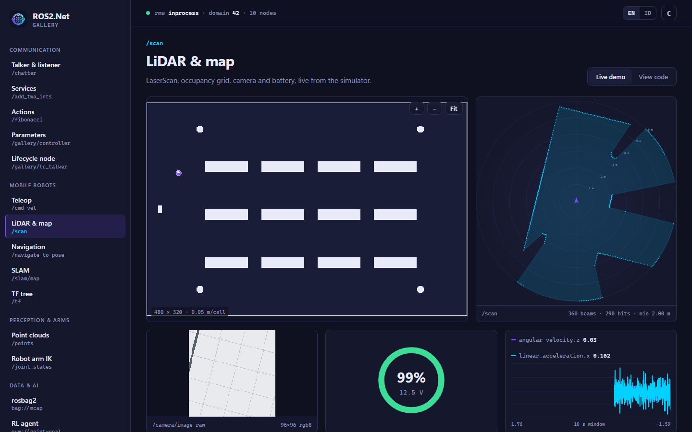

# Komponen Blazor (`ROS2.Net.Blazor`)

Widget ROS 2 langsung (live) untuk Blazor Server dan Blazor Web App (mode render interactive server).
Setiap komponen bisa mengikuti topic sendiri (`Topic="/scan"`) atau menampilkan data yang Anda berikan
(`Scan="@scan"`). Semua digambar dengan SVG dan data URL PNG, jadi tidak perlu pustaka chart atau
canvas dari luar.

> Dibuat oleh Gravicode Studios dipimpin oleh Kang Fadhil.



## Persiapan

```bash
dotnet add package ROS2.Net.Blazor
```

```csharp
// Program.cs
builder.Services.AddRazorComponents().AddInteractiveServerComponents();
builder.Services.AddRos2Blazor(o =>
{
    o.Rmw = "rtps";        // inprocess (bawaan) | rtps | rosbridge
    o.DomainId = 0;
});
```

```razor
@* <head> di App.razor *@
<link rel="stylesheet" href="_content/ROS2.Net.Blazor/ros2net.css" />
<link rel="stylesheet" href="AplikasiAnda.styles.css" />

@* _Imports.razor *@
@using ROS2.Net.Blazor
@using ROS2.Net.Blazor.Components
```

`AddRos2Blazor` dibangun di atas ROS2.Net.Hosting. Ia mendaftarkan satu `Ros2Context` singleton yang
di-spin oleh hosted service dengan executor multi-thread. Komponen meng-inject context ini.

Gunakan mode render interaktif **tanpa prerendering**, misalnya
`new InteractiveServerRenderMode(prerender: false)`. Kalau tidak, setiap komponen akan subscribe dua
kali: sekali saat prerender dan sekali saat circuit dimulai.

## Daftar komponen

| Komponen | Menampilkan | Parameter utama |
|---|---|---|
| `TeleopJoystick` | pad yang bisa diseret plus tombol W A S D / panah → `geometry_msgs/Twist` | `Topic` (`/cmd_vel`), `MaxLinear`, `MaxAngular`, `RateHz`, `OnCommand` |
| `LaserScanView` | `sensor_msgs/LaserScan` sebagai plot polar dengan cincin jarak | `Topic` atau `Scan`, `MaxRange` |
| `OccupancyGridView` | `nav_msgs/OccupancyGrid`, bisa digeser dan di-zoom; overlay robot, jalur, dan goal; klik untuk memilih titik | `Topic` (`/map`) atau `Map`, `PathTopic`/`Path`, `RobotPose`, `Goal`, `OnMapClick`, `Overlay` |
| `PointCloudView` | `sensor_msgs/PointCloud2` atau `PointCloud`, diwarnai berdasarkan ketinggian atau per layer | `Topic`, `Cloud`, `Layers`, `Projection` (Top/Front/Side), `MaxPoints` |
| `TopicMonitor` | semua topic beserta tipe, publisher dan subscriber, laju (Hz), dan bandwidth | `IncludeHidden`, `Exclude`, `Measure` |
| `NodeGraph` | graf node ↔ topic (publish / subscribe) | `IncludeHidden`, `Exclude`, `HideUiNodes` |
| `TfTree` | pohon frame TF beserta offset tiap frame terhadap induknya | `Buffer` (opsional, `TfBuffer` bersama) |
| `ParameterEditor` | parameter node lain, dengan input bertipe, rentang nilai, dan status read-only | `TargetNode` |
| `ImageView` | `sensor_msgs/Image` (encoding apa pun yang bisa dikonversi ROS2.Net.Perception) | `Topic` atau `Image`, `MaxFps` |
| `LogConsole` | `/rosout`, bisa difilter berdasarkan level, node, atau teks | `Topic`, `MaxLines` |
| `LivePlot` | grafik garis real-time dari field numerik pada tipe pesan **apa pun** yang terdaftar | `Topic`, `Fields` (`twist.twist.linear.x`, `ranges[0]`), `WindowSeconds`, atau panggil `Push(series, nilai)` |
| `BatteryGauge` | cincin level baterai dari `sensor_msgs/BatteryState` | `Topic` atau `Percentage` |
| `JointStatePanel` | posisi (dalam derajat) dan kecepatan dari `sensor_msgs/JointState` | `Topic` atau `State` |
| `LifecycleStateView` | mesin status lifecycle node, dengan tombol transisi | `TargetNode` |

```razor
<OccupancyGridView Topic="/map" PathTopic="/plan" RobotPose="@pose" OnMapClick="KirimGoal" />
<LaserScanView Topic="/scan" MaxRange="6" />
<TeleopJoystick Topic="/robot1/cmd_vel" MaxLinear="0.5" />
<LivePlot Topic="/odom" Fields="@(["twist.twist.linear.x", "twist.twist.angular.z"])" />
<ParameterEditor TargetNode="/controller" />
```

## Membuat komponen sendiri: `RosComponentBase`

```razor
@inherits RosComponentBase
<p>@_baterai</p>
@code {
    private string _baterai = "—";
    protected override void OnInitialized() =>
        Subscribe<BatteryState>("/battery_state", b => _baterai = $"{b.Percentage:P0}");
}
```

`RosComponentBase` mengurus hal-hal teknisnya:

- **Node:** setiap komponen mendapat node privat (`Node`) yang dibuat saat pertama dipakai dan dibuang bersama komponen.
- **Subscription:** `Subscribe<T>` membaca topic di task latar belakang, jadi tidak melibatkan executor.
- **Render:** setelah itu ia meminta render ulang, yang digabung hingga paling banyak `RefreshHz` kali per detik (bawaan 30), sehingga topic 100 Hz tidak membanjiri circuit SignalR.
- **Helper lain:**
  - `SubscribeSerialized` memberi CDR mentah untuk tipe yang baru diketahui saat runtime.
  - `Every(period, work)` menjalankan pekerjaan berkala.
  - `Disposing` adalah token pembatalan.

## Tema

Gaya (style) di-scope per komponen. Warna dan font berasal dari variabel CSS di `ros2net.css`, seperti
`--rn-bg`, `--rn-surface`, `--rn-ink`, `--rn-violet`, `--rn-cyan`, `--rn-font`, dan `--rn-mono`. Tema
gelap adalah bawaan. Pasang `data-theme="light"` pada `<html>`, atau pada container mana pun, untuk
palet terang, atau timpa variabelnya sendiri. Warna raster peta tersedia sebagai parameter komponen
(`FreeColor`, `OccupiedColor`, `UnknownColor`), karena piksel PNG tidak bisa membaca CSS.

## Catatan

- Komponen dirender di server. Di Blazor WebAssembly, hanya middleware rosbridge yang bisa berjalan
  di sandbox browser; UDP tidak tersedia di sana.
- `OccupancyGridView` dan `TeleopJoystick` memakai modul JS kecil (`_content/ROS2.Net.Blazor/ros2net.js`)
  untuk ukuran elemen dan menangkap scroll roda mouse. Komponen lain tidak memakai JS sama sekali.
- Pengujian: `tests/ROS2.Net.Blazor.Tests` (bUnit).
