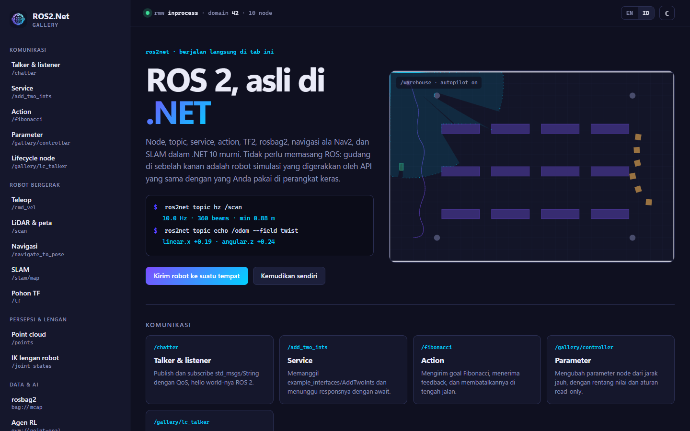
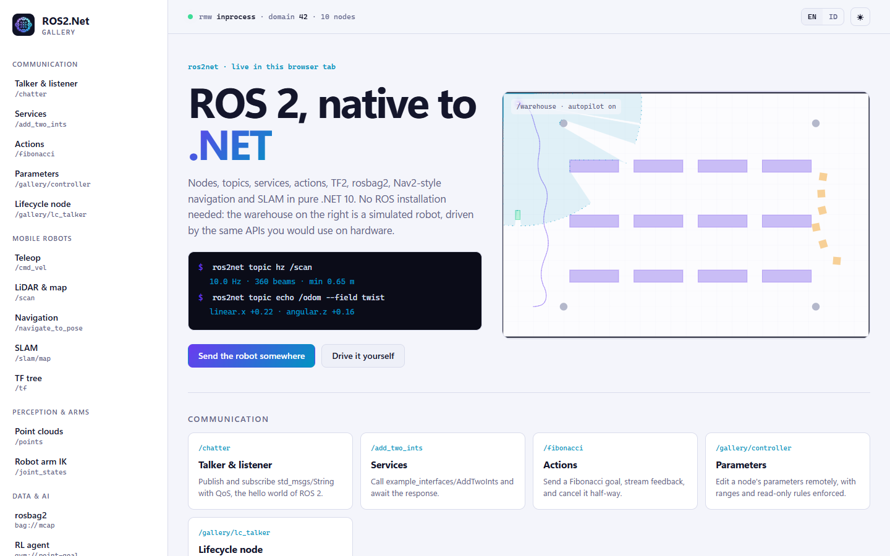
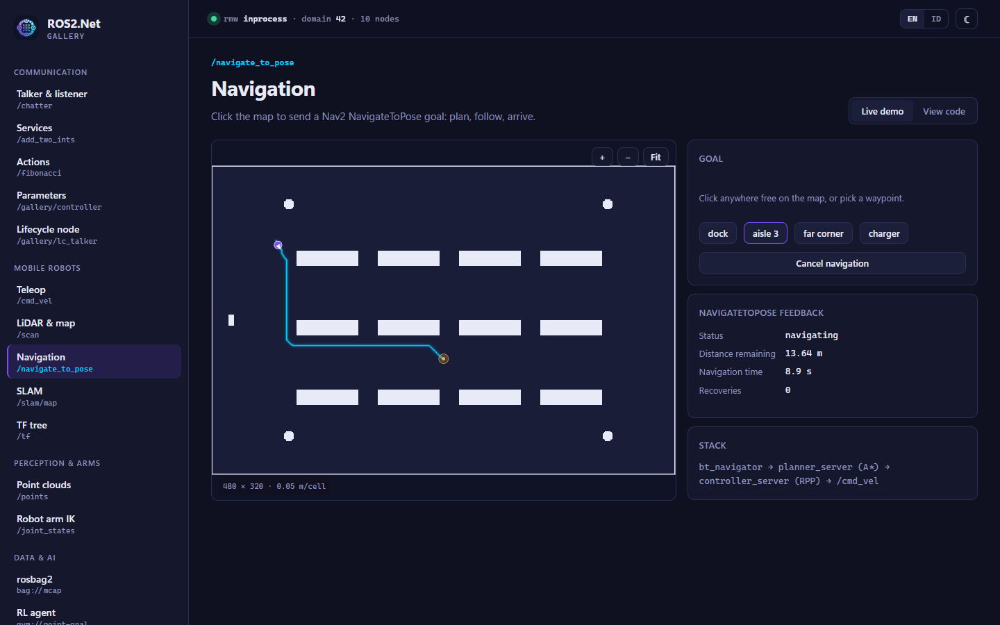
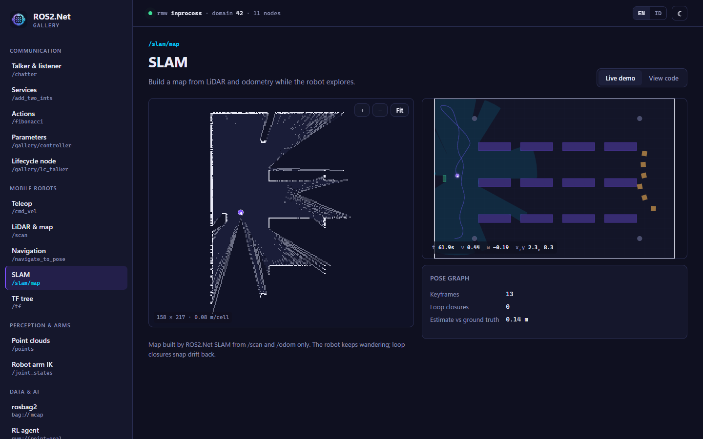

# ROS2.Net Gallery (web)

`apps/ROS2.Net.Gallery.Web` adalah Blazor Web App yang memperlihatkan ROS2.Net lewat 16 demo langsung.
Setiap demo berjalan di tab browser terhadap robot gudang simulasi di middleware in-process. **Tidak
perlu memasang ROS 2.** Setiap halaman punya tab **Demo langsung** dan tab **Lihat kode** berisi
potongan kode yang sesuai. Tampilan bisa beralih antara bahasa Inggris dan Bahasa Indonesia, serta
antara tema gelap dan terang.

> Dibuat oleh Gravicode Studios dipimpin oleh Kang Fadhil.

```bash
cd apps/ROS2.Net.Gallery.Web
dotnet run            # http://localhost:5310 (profil Development)
```



## Apa saja yang berjalan

Saat aplikasi dimulai, `GalleryRuntime` (sebuah hosted service) menjalankan:

- **Simulasi:** dunia `Warehouse` dari ROS2.Net.Simulation dengan satu robot di namespace root. Ia menerbitkan `/cmd_vel`, `/odom`, `/scan`, `/imu`, `/camera/image_raw`, `/battery_state`, `/map`, `/tf`, dan `/clock`.
- **Stack navigasi:** `planner_server`, `controller_server`, dan `bt_navigator` ala Nav2, dengan pose ground-truth sebagai penyedia posenya.
- **Server demo:**
  - `/talker` (menerbitkan `/chatter`)
  - `/add_two_ints`
  - action `/fibonacci`
  - `/gallery/controller` (parameter)
  - `/gallery/lc_talker` (lifecycle node)
- **Autopilot:** penjelajah reaktif yang membuat robot terus bergerak. Halaman yang mengemudikan robot menahannya (`GalleryRuntime.HoldAutopilot()`).

## Halaman

| Halaman | Menampilkan |
|---|---|
| Talker & listener | publish/subscribe, konsol `/rosout` |
| Service | `AddTwoInts`, 100 panggilan bersamaan |
| Action | goal Fibonacci, aliran feedback, pembatalan |
| Parameter | `ParameterEditor` dengan aturan rentang nilai dan read-only, `/parameter_events` |
| Lifecycle node | kontrol mesin status, lifecycle publisher |
| Teleop | joystick atau W A S D → `/cmd_vel`, plot kecepatan langsung |
| LiDAR & peta | occupancy grid, laser scan, kamera, baterai, plot IMU |
| Navigasi | klik peta → `NavigateToPose` → rencana A* → kendali RPP |
| SLAM | peta graph-SLAM langsung dari `/scan` + `/odom`, statistik pose graph |
| Pohon TF | pohon frame, `tf2_echo`, `view_frames` dalam Mermaid |
| Point cloud | voxel, penghapusan outlier, bidang RANSAC, cluster Euclidean (kernel Rust) |
| IK lengan robot | inverse kinematics UR5 lewat slider, `/joint_states` |
| rosbag2 | rekam 5 detik ke MCAP (zstd), `bag info`, putar ulang 2×, ekspor JSONL |
| Agen RL | Q-learning pada lingkungan gym point-goal, kurva return, rollout kebijakan |
| Perintah bahasa | perintah bahasa Inggris atau Indonesia → gerakan aman (model berbasis aturan, offline) |
| Konektivitas | graf node, monitor topic, uji domain RTPS atau URL rosbridge |

Tangkapan layar setiap halaman ada di `docs/images/web/` (lihat versi bahasa Inggris
[gallery-web.md](../en/gallery-web.md) untuk tabel bergambar).





## Terhubung ke sistem ROS 2 sungguhan

Demo memakai middleware in-process agar bisa berjalan di mana saja. Untuk mengendalikan robot
sungguhan, ubah satu baris di `Program.cs`, misalnya `o.Rmw = "rtps"`, lalu lepaskan simulator dari
`GalleryRuntime`. Halaman Konektivitas bisa menguji domain RTPS atau URL rosbridge tanpa restart.

## Tangkapan layar

`tests/ROS2.Net.Blazor.Tests/Screenshots.cs` membuat ulang semua gambar di `docs/images/web` dengan
Playwright dan Microsoft Edge yang terpasang. Chromium bawaan Playwright menjadi cadangan. Test ini
harus diaktifkan secara eksplisit:

```bash
dotnet build apps/ROS2.Net.Gallery.Web
ROS2NET_GALLERY_URL=http://localhost:5317 dotnet test tests/ROS2.Net.Blazor.Tests --filter Screenshots
# atau biarkan test yang menjalankan aplikasinya:
ROS2NET_SCREENSHOTS=1 dotnet test tests/ROS2.Net.Blazor.Tests --filter Screenshots
```

`ROS2NET_SCREENSHOT_PAGES=home,lidar` membatasi halaman yang diambil.

## Catatan desain

- **Palet:** permukaan biru navy pekat dengan aksen ungu → cyan, diambil dari ikon NuGet.
- **Huruf:** Inter (cadangan: Segoe UI) untuk teks; JetBrains Mono (cadangan: Cascadia Code / Consolas) untuk nama ROS.
- **Navigasi:** setiap item menampilkan nama ROS yang dibahasnya (`/navigate_to_pose`, `/scan`, dan seterusnya), sehingga sidebar sekaligus menjadi peta graf ROS.
- **Hero langsung:** beranda menampilkan gudang yang sedang berjalan beserta sapuan LiDAR-nya, plus blok terminal berisi pembacaan nyata dari `/scan` dan `/odom`.
- **Aksesibilitas:** responsif sampai layar ponsel, fokus keyboard terlihat, dan `prefers-reduced-motion` dihormati.
